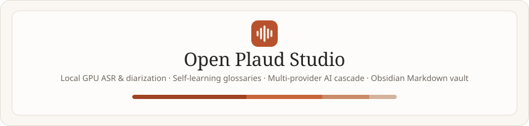
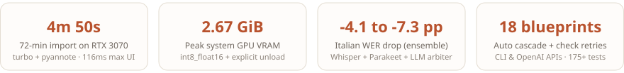
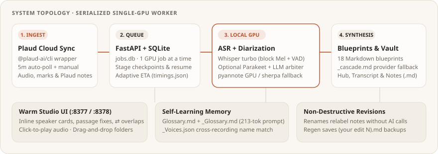
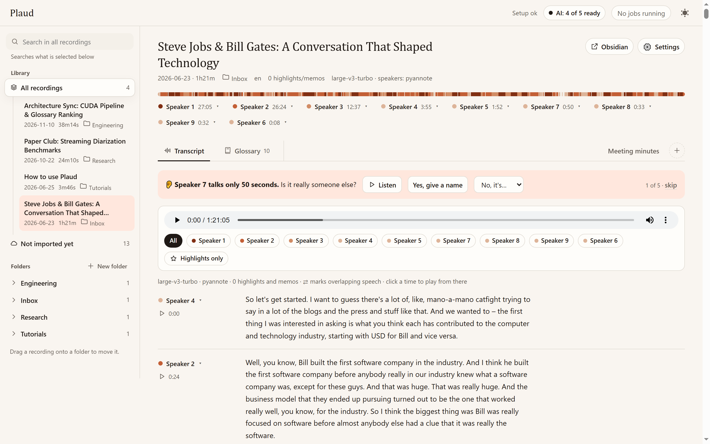
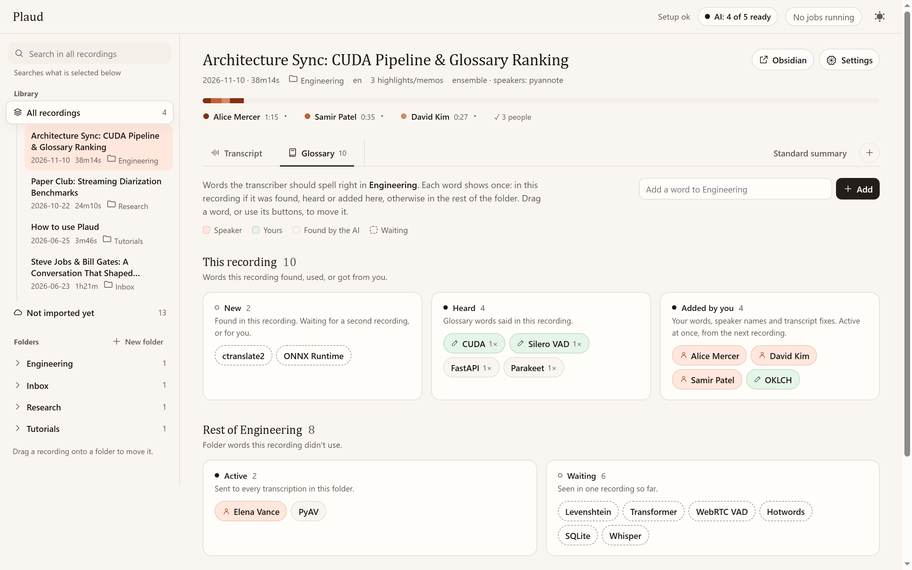
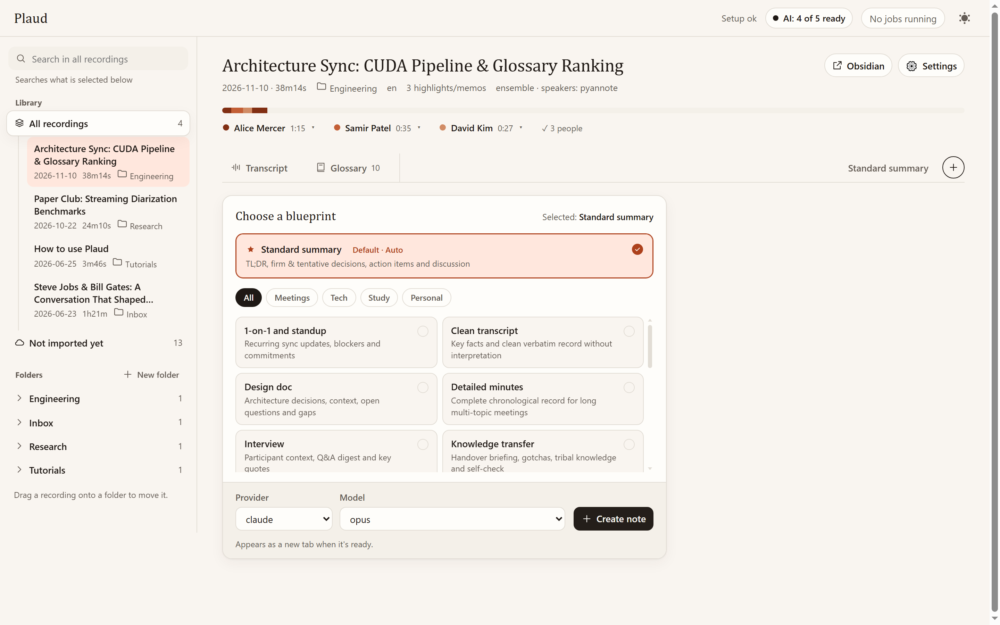

```mermaid
flowchart LR
  P["Plaud Device & Phone App"] -->|Free cloud sync| CLI["@plaud-ai/cli<br/>5m poll · OAuth"]
  CLI --> Q["SQLite Job Queue<br/>jobs.db · serialized worker"]
  Q -->|1. Audio + marks| ASR["faster-whisper<br/>large-v3-turbo · Silero VAD<br/>Block Mel STFT"]
  ASR -->|Optional ensemble| ENS["Parakeet TDT v3 ONNX<br/>+ LLM Arbiter (30s windows)"]
  ASR --> SPK["pyannote community-1 (GPU)<br/>or sherpa-onnx (CPU fallback)"]
  ENS --> SPK
  SPK -->|Utterances + ⇄ overlaps| VAULT["Obsidian Vault<br/>Hub · Transcript · recording.json v2"]
  VAULT -->|Blueprints + _cascade.md| LLM["CLI & OpenAI Providers<br/>claude · codex · antigravity · api · freellmapi"]
  LLM -->|Notes + auto-title + glossary terms| VAULT
```

<div align="center">

<picture>
  <source media="(prefers-color-scheme: dark)" srcset="documentation/assets/hero-dark.svg">
  <source media="(prefers-color-scheme: light)" srcset="documentation/assets/hero-light.svg">
  
</picture>

<br><br>

[](#quickstart)
[](#license)
[](#api-reference)
[](#speech--ensemble-pipeline)
[](#speaker-diarization--voice-id)
[](#obsidian-vault-layout)

<br>

**Capture freely with Plaud hardware. Transcribe, separate speakers, learn domain terms, and synthesize structured notes locally on your own GPU and existing AI subscriptions — stored natively as Obsidian Markdown.**

[Quickstart](#quickstart) · [System Topology](#system-topology) · [Dashboard](#dashboard-tour) · [Pipeline & Models](#speech--ensemble-pipeline) · [Glossaries & Blueprints](#glossaries--blueprints) · [API & Config](#api-reference) · [Benchmarks](#measured-benchmarks)

<br>

<picture>
  <source media="(prefers-color-scheme: dark)" srcset="documentation/assets/telemetry-dark.svg">
  <source media="(prefers-color-scheme: light)" srcset="documentation/assets/telemetry-light.svg">
  
</picture>

</div>

---

## Overview

Recordings sync from your Plaud device to Plaud's cloud through the free Plaud mobile app. From there, **Open Plaud Studio** takes over completely:

1. **Automated & On-Demand Ingestion** — Polls Plaud every 5 minutes via `@plaud-ai/cli`. Recordings created after first startup import automatically; older recordings appear under **Not imported yet** with options to **Import locally** (GPU) or **Import from Plaud** (audio, marks, transcript, and summaries).
2. **VRAM-Bounded Local Speech & Diarization** — Runs `faster-whisper` (`large-v3-turbo`), an optional **Parakeet TDT v3 + LLM Arbiter** ensemble, and **pyannote `speaker-diarization-community-1`** (with automatic CPU `sherpa-onnx` fallback) serially on a single GPU worker.
3. **Interactive Speaker & Voice Intelligence** — Listen to a speaker's 3 longest passages, merge/unmerge voices, move single utterances, confirm counts, and receive cross-recording name suggestions calibrated against confirmed voice prints (`_Voices.json`).
4. **Self-Learning Folder Glossaries** — Extracts terms from AI notes, ensemble disagreements, speaker names, and your transcript edits; promotes terms after 2 recordings (or immediately when marked **Keep**); ranks them inside Whisper's 213-token `hotwords` budget.
5. **Cascading AI Notes & Non-Destructive Vault** — Seeds 18 customizable Markdown blueprints in your Obsidian vault with `_rules.md` quality checks and `_cascade.md` provider fallback. Speaker renames update existing notes with zero AI calls; regeneration backs up your manual edits as `(your edit N).md`.

> [!NOTE]
> **Local-First Architecture:** Self-contained Python + FastAPI + SQLite + Obsidian stack — zero Docker, cloud databases, or external sync servers. See [Owner Handover](documentation/HANDOVER.md) and [Setup on Windows](documentation/SETUP.md) for deployment notes.

---

## System Topology

<div align="center">

<picture>
  <source media="(prefers-color-scheme: dark)" srcset="documentation/assets/topology-dark.svg">
  <source media="(prefers-color-scheme: light)" srcset="documentation/assets/topology-light.svg">
  
</picture>

</div>

<details>
<summary><strong>Stage-by-stage execution flow (Mermaid source)</strong></summary>



</details>

---

## Dashboard Tour

Built in pure HTML/CSS/JS (`app/dashboard.html`) with the **Warm Studio** design system — warm paper / charcoal surfaces, OKLCH terracotta accents, `Iowan Old Style` editorial headings, automatic Light/Dark theme sync with an animated toggle, and a zero-jump polling loop.

<div align="center">

<picture>
  <source media="(prefers-color-scheme: dark)" srcset="documentation/screenshots/dashboard-transcript-dark.png">
  <source media="(prefers-color-scheme: light)" srcset="documentation/screenshots/dashboard-transcript-light.png">
  
</picture>

</div>

| Callout | Dashboard Component | What It Does |
| :---: | :--- | :--- |
| **1** | **Top Status & Controls** | Shows live `doctor` health, **AI** readiness popover (provider checks, inline OpenAI key editor), **Jobs** popover (progress %, live ETA, stage stepper, retry buttons), and animated theme toggle. |
| **2** | **Scoped Sidebar Rail** | Browse **All recordings**, **Not imported yet**, or topic folders. Create pending folders with **New folder**, drag recordings onto folders to move them, and full-text search titles, transcripts, and notes within the active scope. |
| **3** | **Editable Title & Actions** | Click any recording title to rename it (`Enter` saves, `Escape` cancels; filenames remain stable so `[[wikilinks]]` never break). Open directly in **Obsidian** or adjust model/speaker count in **⚙️ Settings**. |
| **4** | **Speaker Strip & Legend** | Proportional talk-time bar (`--s1`–`--s4`). Click any speaker pill to open its card: rename, **Listen** to its 3 longest passages, **Join** duplicate voices, or **Undo** a merge. |
| **5** | **Contextual Ask Banner** | Surfaces one decision at a time: short voices (`< 30s` or `< 2%`), calibrated cross-recording voice suggestions, and speaker-count confirmation (`✓ N people`). |
| **6** | **Sticky Audio & Utterances** | HTML5 audio player (`HTTP Range` streaming), speaker/highlight filter chips, click-any-timestamp playback, `⇄ overlap` indicators, inline ⭐ highlight & ✏️ memo callouts, and per-passage **Who says this?** reassignment. |

<br>

<table>
<tr>
<td width="50%" valign="top">
<picture>
  <source media="(prefers-color-scheme: dark)" srcset="documentation/screenshots/dashboard-glossary-dark.png">
  <source media="(prefers-color-scheme: light)" srcset="documentation/screenshots/dashboard-glossary-light.png">
  
</picture>
<br>
<strong>Glossary Tab — 6-Group Chip Board</strong><br>
<sub>Drag words across <em>New</em>, <em>Heard</em>, <em>Added by you</em>, <em>Active</em>, <em>Waiting</em>, and <em>Blocked</em> (with hover quick-actions, spoken frequency badges, undo toasts, and 409 conflict protection against Obsidian edits).</sub>
</td>
<td width="50%" valign="top">
<picture>
  <source media="(prefers-color-scheme: dark)" srcset="documentation/screenshots/dashboard-newnote-dark.png">
  <source media="(prefers-color-scheme: light)" srcset="documentation/screenshots/dashboard-newnote-light.png">
  
</picture>
<br>
<strong>New Note (+) Tab — Blueprint & Model Tray</strong><br>
<sub>Highlights the <code>Default · Auto</code> blueprint, filters the remaining 17 blueprints across <em>Meetings</em>, <em>Tech</em>, <em>Study</em>, and <em>Personal</em>, and picks any ready AI provider and model per note.</sub>
</td>
</tr>
</table>

---

## Quickstart

### Prerequisites (Windows)

- **Python 3.11**, **Node.js LTS**, and an **NVIDIA CUDA GPU** with a current driver (`ffmpeg` is **not** required — PyAV decodes audio directly).
- Official Plaud CLI authenticated once (`npm install -g @plaud-ai/cli && plaud login`).
- At least one AI provider CLI (`claude`, `codex`, `agy`) or an OpenAI-compatible API endpoint (`OPENAI_API_KEY` or local FreeLLMAPI on `:31415`).

### 1. Install & Verify

```powershell
# Main environment + CUDA ONNX runtime (replace CPU onnxruntime pulled by faster-whisper)
py -3.11 -m venv .venv
.venv\Scripts\python -m pip install -r requirements.txt
.venv\Scripts\python -m pip uninstall -y onnxruntime
.venv\Scripts\python -m pip install --force-reinstall --no-deps 'onnxruntime-gpu[cuda,cudnn]>=1.32'

# Official Plaud CLI
npm install -g @plaud-ai/cli
plaud login

# Optional (recommended): pyannote GPU diarization environment
# Accept terms first: https://huggingface.co/pyannote/speaker-diarization-community-1
py -3.11 -m venv .venv-pyannote
.venv-pyannote\Scripts\python -m pip install pyannote.audio
.venv-pyannote\Scripts\python -m pip install torch==2.14.1 --index-url https://download.pytorch.org/whl/cu126 --force-reinstall --no-deps
.venv\Scripts\hf auth login

# Fetch Parakeet TDT v3 & sherpa-onnx diarization models
.venv\Scripts\python -m app.doctor --fetch-models
```

Create `config.json` in the project root pointing to your Obsidian vault (and optionally `int8_float16` for 8 GiB desktop GPUs):

```json
{
  "vault": "C:/Users/YourName/Documents/Obsidian Vault",
  "whisper_compute_type": "int8_float16"
}
```

### 2. Run, Verify, Autostart & Sandbox

```powershell
# Read-only health check & live AI provider readiness probe
.venv\Scripts\python -m app.doctor
.venv\Scripts\python -m app.doctor --providers

# Start the local server & dashboard -> http://127.0.0.1:8377
.venv\Scripts\python -m app.server

# Register Windows sign-in autostart (current user, no admin required; -Check inspects)
powershell -ExecutionPolicy Bypass -File scripts\autostart.ps1

# Isolated sandbox on http://127.0.0.1:8378 (private vault copy, auto_process disabled)
.venv\Scripts\python scripts\make_sandbox.py
.venv\Scripts\python -m app.server --config data/sandbox/config.json
```

> [!TIP]
> Re-running `scripts\make_sandbox.py` replaces `data/sandbox/` cleanly after validating that no symlinks or junctions exist and verifying the source vault remained idle throughout the copy. Stop the sandbox server first.

---

## Speech & Ensemble Pipeline

| Model Option | Engine | Speed / Footprint | Behavior & Language Gate |
| :--- | :--- | :--- | :--- |
| **`large-v3-turbo`** *(default)* | `faster-whisper` (`CUDA`) | ~28× real time · ~4.2 GiB peak (`int8_float16` / `float16`) | Uses custom 30s `_BlockFeatures` STFT/log-Mel chunking to bound memory on multi-hour audio, Silero VAD (`0.35` threshold), and single-pass language detection (`condition_on_previous_text=False`). |
| **`ensemble`** | `large-v3-turbo` + `nemo-parakeet-tdt-0.6b-v3` + LLM Arbiter | Unloads Whisper before loading Parakeet ONNX; 30s windows in batches of 20 | Arbiter chooses word-by-word using **only** candidate words or glossary terms (`0.6–1.5×` length guard prevents hallucinations). Active only for `ensemble_languages` (default `["it"]`); other languages keep turbo and log `ensemble skipped for <language>`. |
| **`large-v3`** | `faster-whisper` (`CUDA`) | ~12× real time | Retained for side-by-side comparison via **Settings › Transcribe again**. |

- **Post-filtering (`app/pipeline_filters.py`):** Strips configured subtitle/YouTube hallucination lines (`hallucination_blocklist`) and removes consecutive near-duplicate paragraphs (`Levenshtein` similarity `> 0.85`).
- **Marks & Anchors:** Hardware button highlights (`⭐`), typed memos (`✏️`), and photo markers (`📷`) are pulled via `plaud transcript --highlights`, rendered as Obsidian callouts right before their matching utterance, and prioritized in every AI note prompt.

---

## Speaker Diarization & Voice ID

| Engine | Execution | Performance | Details |
| :--- | :--- | :--- | :--- |
| **`pyannote`** *(default)* | `.venv-pyannote` subprocess (`speaker-diarization-community-1`) | ~2 s per min of audio · ~0.7 GiB VRAM cap (`0.4` fraction, batch `8`) | Automatically clears cached Whisper VRAM first. Emits live progress hooks (`segmentation` 0–20%, `embeddings` 20–100%), exclusive turns, and `⇄` overlap intervals. |
| **`sherpa`** *(fallback)* | Built-in `ProcessPoolExecutor` (low CPU priority) | ~0.5× recording duration · 0 VRAM | `sherpa-onnx` pyannote segmentation 3.0 + `3dspeaker_speech_eres2netv2` pooled embeddings with talk-time-weighted cluster merging (`diar_same_voice: 0.85`). |

- **Phrase-Aware Utterances:** Words are grouped into phrases (splitting on punctuation or `> 0.6s` pauses) and assigned to the speaker turn with maximum word overlap, then merged into `25–60s` paragraphs so turn jitter never splits sentences mid-thought.
- **Stable Identity & Redo Inheritance:** Speakers use stable IDs (`S1`, `S2`, …) in `recording.json` (`schema: 2`). **Redo speakers** carries names forward greedily across ≥50% shared talk-time overlap; **Transcribe again** preserves all turns, names, merges, and passage fixes.
- **Cross-Recording Voice Recognition (`<vault>/Plaud/_Voices.json`):** Once at least **3 people** have confirmed voice samples in at least **2 recordings** using the same engine, leave-one-out calibration determines an engine-specific cosine cutoff (≤5% error tolerance) and surfaces inline suggestions (*"Speaker 2 sounds like …"*).

---

## Glossaries & Blueprints

### Self-Learning Glossaries

```text
<vault>/Plaud/<Folder>/Glossary.md   (+ Glossary.json evidence)
<vault>/Plaud/_Glossary.md           (+ _Glossary.json; auto-promoted when active in ≥ 2 folders)
```

| Source / State | Activation Rule | Where It Goes |
| :--- | :--- | :--- |
| **Owner lines** (above `%% Automatic terms below... %%`) | Active immediately | Whisper `hotwords` + Ensemble + Notes |
| **Speaker names & Transcript edits** | Active immediately (even on 1 recording) | Folder `Glossary.md` (`source: name \| correction`) |
| **AI Note `glossary` block & Ensemble diffs** | Needs **2 recordings** in the folder, or manual **Keep** (`use`) | Moves from *New / Waiting* → *Active* |
| **Rejected terms** (below `%% Rejected: never added again %%`) | Never re-suggested unless **Restore** or **Delete for good** | Excluded from all Whisper, Ensemble, and Note prompts |

- **213-Token Whisper Budget & Inbox Sampling:** Whisper receives owner terms and speaker names first, followed by learned terms ranked by evidence and recency. In `Inbox` (`INBOX_POOL = 150`), terms interleave round-robin across all topic folders; if the list exceeds 213 tokens, 4×45-second audio slices are sampled first so folders heard in the recording jump to the front.
- **Move-Safe Evidence:** Dragging a recording to a topic folder in the dashboard moves the entire recording folder and calls `glossary.relocate()` so its learned terms and user-added words follow it automatically.

### Blueprints, Providers & Note Lifecycle

Every recording gets a **Hub note** (`<stem>.md`), a **Transcript note** (`<stem> - Transcript.md`), and any number of `(Blueprint, Provider)` notes inside `<vault>/Plaud/<Folder>/<date title>/`.

<details>
<summary><strong>All 18 built-in blueprints &amp; cascade / provider details</strong></summary>

Default blueprints live in `app/blueprints/` and seed into `<vault>/Plaud/_Blueprints/` when missing (existing user edits are never overwritten). `_rules.md` enforces transcript language, English section headings, zero-invention grounding, and `mm:ss` citations.

| Category | Blueprints |
| :--- | :--- |
| **Auto (Default)** | `Standard summary` (`auto: true` — runs on every new import via `_cascade.md`) |
| **Meetings** | `Detailed minutes`, `1-on-1 and standup`, `Sales and client call`, `Negotiation` |
| **Tech** | `Design doc`, `Knowledge transfer`, `Retro and postmortem` |
| **Study** | `Research meeting`, `Interview`, `Lecture notes`, `Talk and podcast`, `Mind map` |
| **Personal** | `Voice memo`, `Clean transcript`, `Medical visit`, `Legal and formal`, `Site visit` |

**Automatic Cascade (`_cascade.md`):**

```text
1. claude: haiku: medium
2. codex: gpt-6-luna: medium
3. antigravity: gemini-4-hydrogen-medium
4. freellmapi
```

**Configured Providers (`app/config.py`):**

| Provider | Type | Models / Notes |
| :--- | :--- | :--- |
| `claude` | CLI (`stdin`) | `opus`, `sonnet`, `haiku` · `--effort` support · tools disabled |
| `codex` | CLI (`stdin` → `-o`) | Auto-reads `~/.codex/models_cache.json` · `--sandbox read-only` · reasoning effort |
| `antigravity` | CLI (`agy-stream-json`) | Auto-discovers via `agy models` · sandboxed with all write/shell/MCP tools denied |
| `api` | OpenAI HTTP | Default `https://api.openai.com/v1` (`gpt-5`), `OPENAI_API_KEY` editable in dashboard **AI** popover |
| `freellmapi` | OpenAI HTTP | Local FreeLLMAPI desktop app at `http://127.0.0.1:31415/v1` (`FREELLMAPI_API_KEY`) |

- **Prompt Injection Defense:** All CLI providers execute inside an isolated temporary directory with file/shell/MCP/browser tools explicitly disabled so spoken transcript text cannot steer an agent.
- **Non-Destructive Updates:** Speaker renames/merges relabel existing notes instantly without calling an LLM. Transcript/speaker changes `< 2%` stamp `minor_change: true`; `>= 2%` (or ambiguous unmerges) mark notes **Out of date** for manual **Regenerate**, backing up any Obsidian hand edits as `(your edit 1).md`, `(your edit 2).md`, etc. Hub notes preserve everything below `%% Anything you write below this line is kept when this note is regenerated. %%`.

</details>

---

## Obsidian Vault Layout

```text
<vault>/Plaud/
├── _Glossary.md & _Glossary.json            # Global terms (auto-promoted across ≥ 2 folders)
├── _Voices.json                             # Confirmed speaker voice embeddings for name suggestions
├── _Blueprints/
│   ├── _rules.md                            # Shared grounding & citation rules
│   ├── _cascade.md                          # Ordered provider:model:effort fallback for auto notes
│   └── <Blueprint>.md                       # 18 customizable prompt templates (auto, provider, requires)
└── <Folder>/                                # Topic folder (e.g. Inbox, Research, Engineering)
    ├── Glossary.md & Glossary.json          # Per-topic terms + per-recording evidence
    └── <date title>/
        ├── <date title>.ogg                 # Audio file (or MP3 under .ogg path)
        ├── recording.json                   # Schema v2 state (words, turns, embeddings, marks, fixes, history)
        ├── <date title>.md                  # Hub note (audio embed, links, highlights, protected user tail)
        ├── <date title> - Transcript.md     # Diarized transcript with inline mark callouts & ⇄ overlaps
        └── <date title> - <Blueprint> (<provider>).md
```

---

## API Reference

Local state (`jobs.db`, `providers.json`, `provider_models.json`, `discovered_models.json`, `timings.json`, `state.json`, `server.log`) is stored under `data_dir` (default `data/`), keeping the Obsidian vault portable and clean.

| Endpoint | Method | Purpose |
| :--- | :--- | :--- |
| `/` · `/favicon.svg` | `GET` | Warm Studio single-file dashboard & waveform favicon |
| `/api/state` | `GET` | Vault scan (cached by `mtime_ns`), Plaud queue, glossaries, blueprints, providers, live job progress & ETA |
| `/api/recordings/{id}` | `GET` | Recording metadata, utterances, marks, fixes, voice suggestions, and closest-voice map (excludes raw `words`) |
| `/api/audio/{id}` | `GET` | Streams recording audio (`audio/ogg` or `audio/mpeg`) with HTTP `Range` seeking |
| `/api/notes/{id}/{file}` | `GET` | Read-only note Markdown body for dashboard tabs |
| `/api/plaud/{id}` · `/api/refresh` | `GET` · `POST` | Inspect Plaud transcript/summary availability (`2m` cache) or refresh Plaud file list |
| `/api/import` | `POST` | Queue `import` (local GPU), `import_plaud` (cloud pull), or `resume` with target folder, model, and speaker count |
| `/api/retranscribe` · `/api/respeak` | `POST` | Queue word-only re-transcription or speaker re-diarization |
| `/api/generate` · `/api/regenerate` | `POST` | Queue a new `(blueprint, provider, model)` note or regenerate an existing indexed note |
| `/api/move` · `/api/title` | `POST` | Move recording folder (+ relocate glossary evidence) or set owner title |
| `/api/speakers` · `/api/suggestion` | `POST` | Rename speakers / set `true_speakers` (returns `merge_offer` on duplicate names); accept/reject voice match |
| `/api/merge` · `/api/unmerge` | `POST` | Merge or unmerge speaker IDs (`src`, `dst`) and relabel notes |
| `/api/fix` · `/api/unfix` | `POST` | Reassign a time span `[s, e]` to `spk` (or `"new"`) or undo by `fixes` index |
| `/api/recordings/{id}/glossary` | `GET` · `POST` | Fetch 6-group glossary view or apply `add` / `use` / `block` / `restore` / `delete` |
| `/api/check_providers` · `/api/provider_key` · `/api/provider_model` | `POST` | Probe providers (unpausing auth-recovered jobs), update `.env` API key, or persist selected model |
| `/api/retry` | `POST` | Manually re-queue a failed, paused, or delayed job |

---

## Configuration Reference

Override any default in `config.json` (or pass `--config FILE` / `PLAUD_CONFIG`):

| Key | Default | Description |
| :--- | :--- | :--- |
| `vault` / `base_folder` / `inbox` | `~/Documents/Obsidian Vault` / `"Plaud"` / `"Inbox"` | Root Obsidian vault, subfolder, and default landing folder |
| `host` / `port` / `data_dir` | `"127.0.0.1"` / `8377` / `"data"` | Server bind address and local SQLite/log state directory |
| `poll_minutes` / `auto_process` | `5` / `true` | Plaud polling interval and auto-import for recordings since first run |
| `whisper_model` / `whisper_compute_type` | `"large-v3-turbo"` / `"float16"` | Default ASR model and precision (`"int8_float16"` recommended for 8 GiB desktop GPUs) |
| `ensemble_languages` / `parakeet_dir` | `["it"]` / `"models/parakeet-v3"` | Languages eligible for Whisper + Parakeet + Arbiter fusion |
| `auto_glossary_whisper` | `true` | Include eligible learned terms (not just owner terms & names) in Whisper `hotwords` |
| `diar_engine` / `diar_same_voice` | `"pyannote"` / `0.85` | Primary diarizer (`pyannote` GPU or `sherpa` CPU) and cosine merge threshold |
| `default_provider` / `arbiter_provider` | `"claude"` / `default_provider` | Default note provider and ensemble arbitration provider |

---

## Measured Benchmarks

> [!IMPORTANT]
> Proxy accuracy metrics below compare local output against Plaud's own transcript and speaker labels (not human ground truth). Full per-recording tables and memory traces are documented in [EVAL-BASELINE.md](documentation/EVAL-BASELINE.md).

| Benchmark | Measured Result | Conditions |
| :--- | :--- | :--- |
| **72-min End-to-End Import** (`11-10`) | **4m 50s** (`290.21 s`) · max UI latency **115.67 ms** | RTX 3070 · `large-v3-turbo` (`int8_float16`) · `pyannote` batch `8` · peak system VRAM **2.67 GiB** (`2729 MiB`) · ≥ 12.2 GiB RAM free |
| **Italian WER vs. Plaud** (3 meetings) | **-4.07 to -7.33 pp** improvement with `ensemble` | `19.57% → 14.88%` (`07-23`) · `14.17% → 10.10%` (`09-29`) · `27.56% → 20.23%` (`11-10`) |
| **English WER vs. Plaud** (`Jobs & Gates`) | `7.55%` (`turbo`) vs. `7.67%` (`ensemble`) | `"en"` excluded from `ensemble_languages`; English runs `large-v3-turbo` directly |
| **Automatic Glossary Impact** (Italian) | Term errors **12 → 9** · Pooled WER **21.81% → 19.81%** | Measured with `auto_glossary_whisper: true` across 3 Italian recordings |
| **Speaker Counts** | Exact match on all 3 Italian recordings (`3, 3, 2`) | `pyannote community-1` default settings; 89–96% agreement with Plaud labels |

---

## Tests & Evaluation

```powershell
# Full offline test suite (excludes 3 live provider CLI checks that consume quota)
.venv\Scripts\python -m pytest tests -q -k "not injection_fixture_cannot_write_outside_temp"

# Full suite including installed provider CLI sandboxing checks
.venv\Scripts\python -m pytest tests -q

# Score a recording against Plaud's transcript and speaker labels (proxy)
.venv\Scripts\python eval\run.py <recording.json> [plaud.txt]
.venv\Scripts\python eval\score_rec.py <recording.json> <plaud.txt>
```

---

## License

Licensed under the [Apache License 2.0](LICENSE) (`AS IS`, without warranties or liability, with explicit patent and trademark protections).

This is an independent, local-first companion project that interacts with your own Plaud account strictly through the official `@plaud-ai/cli` tool and is not affiliated with, endorsed by, or sponsored by Plaud.

