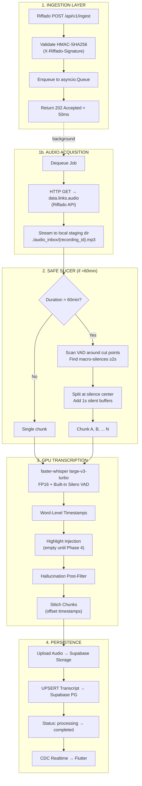

# Phase 2: SOTA Python Signal Processing Pipeline (v2.0)

> **Mission:** Achieve local STT transcription ≥ Plaud cloud quality on 8GB VRAM GPU.

---

## Resolved Questions (Answers from User — Preserved for Executor Context)

### Q1: Riffado Webhook Event Name
> **Answer:** `recording.synced` — confirmed by live webhook capture AND [Riffado source code](file:///c:/Users/<user>/Antigravity%20Projects/riffado/src/lib/webhooks/emit.ts#L8).

### Q2: Riffado Payload Schema
> **Answer:** Real payload captured from live Riffado instance. See [webhook_dump.json](file:///c:/Users/<user>/Antigravity%20Projects/plaud-backend/webhook_dump.json).
>
> **CRITICAL FINDING:** The payload does NOT contain a local file path. Audio is served via HTTP at `data.links.audio`. The pipeline must HTTP GET the audio from Riffado's API, not read from disk.

```json
{
  "event": "recording.synced",
  "delivered_at": "2026-06-26T10:30:50.002Z",
  "data": {
    "id": "ENpHmSsHQz6t7DkqluucJ",
    "title": "2026-06-26 12:27:21",
    "created_at": "2026-06-26T10:30:49.994Z",
    "updated_at": "2026-06-26T10:51:18.158Z",
    "recorded_at": "2026-06-26T10:27:21.000Z",
    "duration_ms": 69000,
    "filesize_bytes": 295424,
    "device": {
      "serial_number": "8810B50275329866",
      "name": "Plaud Note Pro",
      "model": "881"
    },
    "has_transcription": false,
    "has_summary": false,
    "links": {
      "self": "http://localhost:3000/api/v1/recordings/ENpHmSsHQz6t7DkqluucJ",
      "transcript": "http://localhost:3000/api/v1/recordings/ENpHmSsHQz6t7DkqluucJ/transcript",
      "audio": "http://localhost:3000/api/v1/recordings/ENpHmSsHQz6t7DkqluucJ/audio"
    },
    "transcript": null,
    "summary": null,
    "api_url": "http://localhost:3000/api/v1/recordings/ENpHmSsHQz6t7DkqluucJ"
  }
}
```

### Q3: Audio Format
> **Answer:** Riffado serves `.mp3`. Plaud Note Pro records native `.wav` but compresses to `.mp3` for Bluetooth sync. Support both for future-proofing. `faster-whisper` uses FFmpeg internally → seamlessly decodes both to 16kHz Mono. Pipeline doesn't need to care about extension.

### Q4: Language
> **Answer:** Mixed Italian + English. Auto-detect (`language=None`). Unlikely but possible both languages appear in single recording. Hallucination blocklist must cover both Italian and English phrases.

### Q5: Max Recording Length
> **Answer:** Up to **2.5 hours** once silent states removed. Implement a **Safe Slicing Algorithm** that cuts based on acoustic topography (macro-silences), not arbitrary time boundaries.

### Q6: Concurrent Recordings
> **Answer:** Yes. Batch syncs occur when Plaud Note Pro reconnects after days offline (e.g., Barcelona trip scenario). Queue depth must handle 5-10 recordings arriving rapidly. Processing remains sequential (single GPU).

### Q7: VRAM Dedication
> **Answer:** GPU dedicated to this pipeline. FP16 confirmed. No concurrent CUDA apps.

### Q8: Schema Extension
> **Answer:** Approved. Adding `status`, `language`, `word_count` columns.

---

## Critical Architectural Findings from Riffado Source Code Analysis

> [!CAUTION]
> **Highlights / Hardware Button Timestamps are NOT available through Riffado.**
>
> Deep analysis of Riffado's full source code reveals:
> - [schema.ts](file:///c:/Users/<user>/Antigravity%20Projects/riffado/src/db/schema.ts#L204-L267): `recordings` table has **zero columns** for highlights, bookmarks, or button-press timestamps.
> - [serialize.ts](file:///c:/Users/<user>/Antigravity%20Projects/riffado/src/lib/v1/serialize.ts#L141-L172): Webhook payload serializer has **no highlight fields**.
> - grep for `highlight`, `bookmark`, `button_press`, `button_timestamp`, `flag` across entire Riffado `src/` → **zero matches** related to recording markers.
>
> **Root Cause:** Plaud stores button-press timestamps in its proprietary cloud. Riffado intercepts raw audio files from Plaud's sync API but this metadata is not part of the file download response Riffado captures.
>
> **Architectural Decision:** The highlight injection algorithm (Component 6) is **retained in the codebase** but with an **empty highlights array by default**. The feature will be activated in Phase 4 (Flutter) via manual in-app timestamp tagging by the user while listening. This is actually a superior UX — the user marks moments while reviewing, not while multitasking in a meeting.

> [!IMPORTANT]
> **Webhook Signature Verification — Exact Riffado Protocol:**
>
> Verified from [signature.ts](file:///c:/Users/<user>/Antigravity%20Projects/riffado/src/lib/webhooks/signature.ts):
> - Header name: `X-Riffado-Signature`
> - Format: `t={unix_timestamp},v1={hex_hmac}`
> - HMAC payload: `{timestamp}.{body}` (timestamp dot body)
> - Algorithm: `HMAC-SHA256(secret, f"{timestamp}.{body}")`
> - Tolerance: 300 seconds (5 min)
> - Additional headers sent: `X-Riffado-Event`, `X-Riffado-Delivery`, `X-Riffado-Timestamp`

---

## Architecture Overview



---

## Proposed Changes

### Component 1: Project Structure

#### [NEW] Final directory tree

```
plaud-backend/
├── app/
│   ├── __init__.py
│   ├── main.py              # FastAPI app + lifespan + webhook route
│   ├── config.py             # Pydantic Settings (env-driven)
│   ├── models.py             # Pydantic request/response schemas
│   ├── worker.py             # Async background consumer (GPU pipeline)
│   ├── pipeline/
│   │   ├── __init__.py
│   │   ├── transcriber.py    # Whisper model lifecycle + transcription
│   │   ├── slicer.py         # Safe Slicing Algorithm for long recordings
│   │   ├── highlights.py     # Timestamp→text injection (dormant until Phase 4)
│   │   └── postfilter.py     # Hallucination blocklist + repetition guard
│   └── services/
│       ├── __init__.py
│       ├── riffado_client.py # HTTP audio download from Riffado API
│       └── supabase_client.py # Storage upload + DB upsert
├── .env                       # Secrets (never committed)
├── .env.example               # Template
├── requirements.txt
├── config.yaml                # LiteLLM (Phase 3, stub only)
└── GEMINI.md
```

**Changes from v1:**
- Added `slicer.py` (Safe Slicing for 2.5hr recordings)
- Added `riffado_client.py` (HTTP audio download — audio isn't local)
- Renamed `vad.py` → removed (VAD config now inline in `transcriber.py` — built-in VAD params)

---

### Component 2: Configuration — `config.py`

#### [NEW] [config.py](file:///c:/Users/<user>/Antigravity%20Projects/plaud-backend/app/config.py)

| Setting | Type | Default | Purpose |
|---|---|---|---|
| `SUPABASE_URL` | `str` | *required* | Supabase project URL |
| `SUPABASE_SERVICE_KEY` | `SecretStr` | *required* | Service-role key (server-side only) |
| `SUPABASE_BUCKET` | `str` | `"recordings"` | Storage bucket name |
| `RIFFADO_BASE_URL` | `str` | `"http://localhost:3000"` | Riffado instance base URL |
| `RIFFADO_WEBHOOK_SECRET` | `SecretStr \| None` | `None` | HMAC-SHA256 signing secret |
| `WHISPER_MODEL` | `str` | `"large-v3-turbo"` | Model identifier |
| `WHISPER_DEVICE` | `str` | `"cuda"` | `cuda` or `cpu` |
| `WHISPER_COMPUTE_TYPE` | `str` | `"float16"` | Precision |
| `WHISPER_LANGUAGE` | `str \| None` | `None` | `None` = auto-detect (IT/EN mixed) |
| `WHISPER_BEAM_SIZE` | `int` | `5` | Beam search width |
| `WHISPER_BATCH_SIZE` | `int` | `8` | Batched inference batch size |
| `VAD_THRESHOLD` | `float` | `0.35` | Speech probability threshold |
| `VAD_MIN_SILENCE_MS` | `int` | `500` | Min silence to split |
| `VAD_SPEECH_PAD_MS` | `int` | `300` | Padding around speech |
| `MAX_QUEUE_SIZE` | `int` | `10` | Backpressure limit (handles batch syncs) |
| `LOCAL_AUDIO_DIR` | `str` | `"./audio_inbox"` | Temp audio staging dir |
| `SAFE_SLICE_MAX_MINUTES` | `int` | `60` | Threshold to trigger Safe Slicing |
| `SAFE_SLICE_WINDOW_MINUTES` | `int` | `4` | Scan window around cut point (±2min) |
| `SAFE_SLICE_MIN_SILENCE_SEC` | `float` | `2.0` | Minimum macro-silence for cut |
| `SAFE_SLICE_BUFFER_SEC` | `float` | `1.0` | Silent buffer padding at chunk edges |
| `HALLUCINATION_BLOCKLIST` | `list[str]` | see below | Known hallucination phrases |
| `AUDIO_DOWNLOAD_TIMEOUT` | `int` | `120` | HTTP download timeout in seconds |

**Blocklist defaults (Italian + English):**
```python
[
    # English
    "Thanks for watching",
    "Thank you for watching",
    "Subtitles by",
    "Please subscribe",
    "Like and subscribe",
    "Copyright",
    "Amara.org",
    "www.mooji.org",
    # Italian
    "Grazie per la visione",
    "Sottotitoli di",
    "Sottotitoli a cura di",
    "Iscriviti al canale",
    "Sottotitoli creati dalla comunità",
    "MBC 뉴스",
]
```

---

### Component 3: Data Models — `models.py`

#### [NEW] [models.py](file:///c:/Users/<user>/Antigravity%20Projects/plaud-backend/app/models.py)

**Matched exactly to Riffado source** ([serialize.ts](file:///c:/Users/<user>/Antigravity%20Projects/riffado/src/lib/v1/serialize.ts)):

```python
# === Riffado Webhook Payload (exact match to source) ===

class RiffadoDevice(BaseModel):
    serial_number: str
    name: str
    model: str

class RiffadoLinks(BaseModel):
    self_url: str = Field(alias="self")  # "self" is reserved in Python
    transcript: str
    audio: str                           # THE KEY FIELD — HTTP URL to stream audio

class RiffadoTranscriptPreview(BaseModel):
    """Only present if Riffado already transcribed (has_transcription=true)"""
    preview: str
    truncated: bool
    length: int
    language: str | None = None
    provider: str | None = None
    model: str | None = None
    created_at: str | None = None

class RiffadoRecordingData(BaseModel):
    model_config = ConfigDict(extra="allow")  # Future-proof
    id: str                                    # nanoid — "ENpHmSsHQz6t7DkqluucJ"
    title: str                                 # "2026-06-26 12:27:21"
    created_at: str
    updated_at: str
    recorded_at: str
    duration_ms: int                           # milliseconds!
    filesize_bytes: int
    device: RiffadoDevice | None = None
    has_transcription: bool = False
    has_summary: bool = False
    links: RiffadoLinks
    transcript: RiffadoTranscriptPreview | None = None
    summary: dict | None = None
    api_url: str

class RiffadoWebhookPayload(BaseModel):
    model_config = ConfigDict(extra="allow")
    event: str                                 # "recording.synced"
    delivered_at: str
    data: RiffadoRecordingData

# === Internal Job (passed to worker) ===

class TranscriptionJob(BaseModel):
    recording_id: str          # Riffado recording nanoid
    audio_url: str             # HTTP URL to GET audio from Riffado
    title: str
    duration_ms: int
    recorded_at: str
    device_name: str | None = None
    highlights: list[float] = []  # Empty until Phase 4 Flutter manual tagging

# === Supabase Row Shape ===

class TranscriptRow(BaseModel):
    title: str
    audio_path: str            # Supabase Storage path
    raw_text: str
    duration_seconds: float | None
    highlights: list[float]    # JSONB — empty until Phase 4
    status: str                # "processing" | "completed" | "failed"
    language: str | None
    word_count: int
    ai_features: dict = {}     # JSONB
```

---

### Component 4: Ingestion Layer — `main.py`

#### [NEW] [main.py](file:///c:/Users/<user>/Antigravity%20Projects/plaud-backend/app/main.py)

**Solving Hurdle #1: The Ingestion Bottleneck**

**Architecture decision:** `asyncio.Queue` over Redis/Celery.

**Rationale:** Single-instance, single-GPU. Redis adds infra complexity for zero benefit. Riffado has built-in retry w/ exponential backoff ([worker.ts L37](file:///c:/Users/<user>/Antigravity%20Projects/riffado/src/lib/webhooks/worker.ts#L37): `BACKOFF_MS = [30s, 2min, 10min, 1hr, 6hr]`). If our process dies → Riffado retries up to 5 times → no data loss.

**Lifespan pattern:**
```
1. FastAPI startup:
   a. Load Whisper model ONCE into GPU (singleton)
   b. Initialize httpx.AsyncClient (for Riffado audio download)
   c. Create asyncio.Queue(maxsize=MAX_QUEUE_SIZE)  # 10 = handles batch syncs
   d. Spawn background asyncio.Task → worker consumer loop

2. FastAPI shutdown:
   a. Send poison-pill sentinel to queue
   b. Await worker task completion (with timeout)
   c. Close httpx.AsyncClient
   d. Delete model reference + gc.collect()
```

**Webhook endpoint** (`POST /api/v1/ingest`):
```
1. Read raw request body bytes (needed for HMAC)
2. If RIFFADO_WEBHOOK_SECRET configured:
   a. Extract "X-Riffado-Signature" header
   b. Extract "X-Riffado-Timestamp" header
   c. Parse signature: split on "," → dict of "t" and "v1"
   d. Verify timestamp within ±300s tolerance
   e. Compute HMAC-SHA256(secret, f"{timestamp}.{body_bytes}")
   f. timing-safe compare hex digests → 401 on mismatch
3. Parse body → RiffadoWebhookPayload
4. Validate event == "recording.synced" (ignore others → 204 No Content)
5. Build TranscriptionJob:
   - recording_id = payload.data.id
   - audio_url = payload.data.links.audio  # HTTP URL, not file path!
   - title = payload.data.title
   - duration_ms = payload.data.duration_ms
   - recorded_at = payload.data.recorded_at
   - device_name = payload.data.device.name if payload.data.device else None
   - highlights = []  # Not available from Riffado
6. Try queue.put_nowait(job):
   a. Success → return 202 {"status": "queued", "recording_id": ...}
   b. QueueFull → return 503 {"error": "pipeline busy, retry later"}
      (Riffado's backoff will retry in 30s)
```

**Health endpoint** (`GET /api/v1/health`):
```python
{
    "status": "ok",
    "queue_depth": queue.qsize(),
    "model_loaded": transcriber is not None,
    "gpu_vram_used_mb": "..."  # nvidia-smi or pynvml if available
}
```

---

### Component 5: Audio Acquisition — `riffado_client.py`

#### [NEW] [riffado_client.py](file:///c:/Users/<user>/Antigravity%20Projects/plaud-backend/app/services/riffado_client.py)

**New component — audio is remote, not local.**

```
PURPOSE: Stream-download audio from Riffado's API to local staging dir.

LOGIC:
1. Receive audio_url (e.g., "http://localhost:3000/api/v1/recordings/{id}/audio")
2. Use shared httpx.AsyncClient with:
   - timeout = AUDIO_DOWNLOAD_TIMEOUT (120s)
   - follow_redirects = True  (Riffado audio endpoint may redirect to S3/local storage)
3. Stream response body to: {LOCAL_AUDIO_DIR}/{recording_id}.mp3
   - Streaming avoids loading 100MB+ files into RAM
   - Write chunks of 64KB
4. Verify file size > 0 bytes after download
5. Return local file path

ERROR HANDLING:
- HTTP 404 → Recording deleted between webhook and download → mark "failed"
- Timeout → Log + raise → worker catches → marks "failed" in DB
- Disk full → Raise → worker catches
```

**Why `httpx` over `requests`:**
- `httpx.AsyncClient` = async-native, plays well w/ FastAPI event loop
- Connection pooling across multiple downloads (batch sync scenario)
- Streaming downloads without blocking event loop

---

### Component 6: Safe Slicing Algorithm — `slicer.py`

#### [NEW] [slicer.py](file:///c:/Users/<user>/Antigravity%20Projects/plaud-backend/app/pipeline/slicer.py)

**Solving the 2.5-hour recording problem.**

> [!IMPORTANT]
> **User's acoustic topography concept accepted and refined.** Never cut at arbitrary time boundaries. Always cut at macro-silences.

**User's `pydub` suggestion → rejected in favor of `ffmpeg` subprocess.**

**Rationale:** `pydub` loads entire file as raw PCM in RAM. A 2.5hr MP3 → ~1.5GB RAM. `ffmpeg` subprocess does zero-copy seeking and splitting. Already a dependency of `faster-whisper`. No new install needed.

**The Algorithm:**

```
INPUT: audio_file_path, max_chunk_minutes=60

STEP 0: DURATION CHECK
  - Read file duration via ffprobe (subprocess, ~10ms)
  - If duration ≤ max_chunk_minutes → return [audio_file_path] (no slicing)

STEP 1: COMPUTE CUT POINTS
  - For a 150-min file with 60-min max: target cuts at [60min, 120min]
  - For each target cut time T:

STEP 2: HUNT FOR MACRO-SILENCE
  - Extract a narrow audio window: [T - 2min, T + 2min]
    via ffmpeg: ffmpeg -ss {start} -t 240 -i {file} -ar 16000 -ac 1 -f wav pipe:1
    (4-minute window, 16kHz mono, piped to memory — only ~7.7MB for 4 min)
  - Run Silero VAD on this 4-minute snippet (CPU-only, ~50ms)
  - Find all silence gaps ≥ SAFE_SLICE_MIN_SILENCE_SEC (2.0s)
  - Select the silence gap closest to the target cut time T
  - If NO silence gap found in window → widen window to ±4min and retry
  - If still none → force cut at target T (worst case, rare in meetings)

STEP 3: EXECUTE CUTS
  - For each confirmed cut point C (center of silence gap):
    a. ffmpeg -ss 0 -t {C + buffer} -i {file} -c copy chunk_A.mp3
    b. ffmpeg -ss {C - buffer} -i {file} -c copy chunk_B.mp3
    (Using -c copy = no re-encoding, instant, lossless)
  - The 1-second overlap (buffer) gives Whisper a "soft runway"

STEP 4: RETURN
  - Return list of chunk file paths in order
  - Return list of chunk start offsets (for timestamp re-mapping)

OUTPUT:
  chunks: [
    {"path": "chunk_0.mp3", "offset_seconds": 0.0},
    {"path": "chunk_1.mp3", "offset_seconds": 3598.5},  # actual cut point
    ...
  ]
```

**Why this beats naive chunking:**
- Cutting mid-sentence → Whisper hallucinates startup text on chunk B
- Cutting at macro-silence → both chunks start/end at natural conversation breaks
- 1s silent buffer → Whisper has clean acoustic context to initialize decoder

---

### Component 7: The Transcription Engine — `transcriber.py`

#### [NEW] [transcriber.py](file:///c:/Users/<user>/Antigravity%20Projects/plaud-backend/app/pipeline/transcriber.py)

**Solving Hurdles #2 (Hallucination) and #3 (8GB VRAM)**

**7.1 — Model Initialization (Singleton)**

```python
WhisperModel(
    model_size_or_path="large-v3-turbo",
    device="cuda",
    compute_type="float16",
    cpu_threads=4,
    num_workers=1,           # Single GPU = single worker
)
```

**Why:**
- `large-v3-turbo` = distilled (32→4 decoder layers). ~3.5–4.5 GB VRAM @ FP16.
- GPU dedicated → full FP16 → maximum accuracy.
- `num_workers=1` → no CTranslate2 worker contention.
- `cpu_threads=4` → auxiliary CPU ops (feature extraction).

**7.2 — Transcription Call (SOTA Anti-Hallucination Config)**

```python
segments, info = model.transcribe(
    audio_path,
    language=None,                         # Auto-detect IT/EN
    beam_size=5,
    best_of=5,
    patience=1.0,
    word_timestamps=True,                  # CRITICAL for highlight mapping

    # === HALLUCINATION PREVENTION ===
    condition_on_previous_text=False,      # KILL feedback loops
    no_speech_threshold=0.6,               # Aggressive silence gating
    log_prob_threshold=-1.0,               # Default
    compression_ratio_threshold=2.4,       # Catches repetition loops
    repetition_penalty=1.1,               # Penalize token repetition

    # === BUILT-IN VAD (Silero, CTranslate2-optimized) ===
    vad_filter=True,
    vad_parameters=dict(
        threshold=0.35,                    # Sensitive for meeting audio
        min_silence_duration_ms=500,
        speech_pad_ms=300,
        min_speech_duration_ms=250,        # Skip micro-bursts
        max_speech_duration_s=float("inf"),
    ),
)
```

**Why built-in VAD over external Silero:**
- Same Silero model BUT batched ONNX variant optimized for CTranslate2.
- ~5% better downstream accuracy due to aligned chunking context.
- Zero additional VRAM (runs on CPU-side ONNX).
- External Silero = custom code, timestamp alignment bugs, no benefit.

**7.3 — Multi-Chunk Processing**

```
For each chunk from slicer:
  1. Run model.transcribe(chunk.path, ...)
  2. Collect all Word objects
  3. Offset all word timestamps: word.start += chunk.offset_seconds
  4. Append to global word list

Final: single continuous word list with correct absolute timestamps
```

**7.4 — VRAM Lifecycle**

> `torch.cuda.empty_cache()` does **nothing** for faster-whisper. CTranslate2 manages its own CUDA memory.

**Strategy: Persistent Singleton + Sequential Processing**
- Model loaded ONCE at startup → stays in VRAM entire app lifetime
- Jobs processed SEQUENTIALLY (single consumer loop)
- No model reload between jobs → no leak from init/destroy
- CTranslate2 reuses internal workspace buffers → stable VRAM

**OOM Recovery (defensive only):**
```
try:
    segments, info = model.transcribe(...)
except RuntimeError as e:
    if "out of memory" in str(e).lower():
        del model; gc.collect()
        model = WhisperModel(...)  # Re-initialize
        logger.critical(f"OOM recovery triggered for {recording_id}")
        raise  # Let worker mark as "failed", retry on next webhook
```

---

### Component 8: Highlight Injection — `highlights.py`

#### [NEW] [highlights.py](file:///c:/Users/<user>/Antigravity%20Projects/plaud-backend/app/pipeline/highlights.py)

**Status: Code retained, dormant until Phase 4.**

Riffado does not expose hardware button timestamps. This module accepts an empty `highlights=[]` array by default → no-op.

In Phase 4, Flutter app will allow users to tap a "Mark" button while listening to playback. Those timestamps POST to a new endpoint → stored in `highlights` JSONB column → re-processing or post-injection applies this algorithm.

**Algorithm (Word-Level Precision) — ready for activation:**

```
INPUT:
  - words: List[Word] (each .start, .end, .word)
  - highlights: List[float] sorted ascending
  - tolerance: float = 1.5s

ALGORITHM:
  1. If highlights is empty → return plain concatenated text (no-op path)
  2. Sort highlights ascending
  3. Initialize highlight_pointer = 0
  4. For each word:
     While highlight_pointer < len(highlights):
        hl = highlights[highlight_pointer]
        if word.start - tolerance <= hl <= word.end + tolerance:
            → Insert marker BEFORE this word
            → Advance pointer (may match multiple)
        elif hl < word.start - tolerance:
            → Highlight in silence gap → attach to nearest next word
            → Advance pointer
        else: break
     Append word to output
  5. Trailing highlights → append markers at end

MARKER FORMAT:

> ⚠️ **USER HIGHLIGHTED MOMENT**

EDGE CASES:
  - Empty highlights → pure no-op, zero overhead
  - Highlight before first word → prepend
  - Highlight after last word → append
  - Multiple highlights on same word → stack markers
  - Highlight at exact boundary → matches, no duplication
```

---

### Component 9: Hallucination Post-Filter — `postfilter.py`

#### [NEW] [postfilter.py](file:///c:/Users/<user>/Antigravity%20Projects/plaud-backend/app/pipeline/postfilter.py)

**Defense-in-depth AFTER transcription** (VAD = pre-filter):

```
1. BLOCKLIST SCAN:
   - Split transcript into lines
   - For each line:
     If line.strip() case-insensitive matches ANY blocklist entry:
       → Remove entire line
       → Log: "Filtered hallucination: {line}"
   - Covers both Italian and English phrases

2. REPETITION DETECTOR:
   - Split transcript into segments (by paragraph/double-newline)
   - Sliding window of 3 consecutive segments
   - If Levenshtein similarity > 0.85 between adjacent segments:
     → Keep first occurrence, remove duplicates
     → Log: "Removed {count} repeated segments"

3. WHITESPACE CLEANUP:
   - Collapse 3+ consecutive newlines → 2
   - Strip trailing whitespace
   - Trim leading/trailing blank lines
```

---

### Component 10: Background Worker — `worker.py`

#### [NEW] [worker.py](file:///c:/Users/<user>/Antigravity%20Projects/plaud-backend/app/worker.py)

**The consumer loop tying everything together:**

```
async def worker_loop(queue, transcriber, riffado_client, supabase_client, settings):
    while True:
        job = await queue.get()
        if job is SENTINEL:
            break

        row_id = None
        local_path = None

        try:
            # 1. INSERT placeholder → CDC fires → Flutter shows "Processing..."
            row_id = await supabase_client.insert_processing(job)

            # 2. DOWNLOAD audio from Riffado API
            local_path = await riffado_client.download_audio(
                job.audio_url, job.recording_id
            )

            # 3. SAFE SLICE if needed (>60 min)
            chunks = slicer.slice_if_needed(local_path, settings)

            # 4. TRANSCRIBE each chunk sequentially
            all_words = []
            detected_language = None
            total_duration = 0.0

            for chunk in chunks:
                segments, info = transcriber.transcribe(chunk.path)
                if detected_language is None:
                    detected_language = info.language
                for segment in segments:
                    for word in (segment.words or []):
                        # Offset timestamps for stitched chunks
                        word_copy = Word(
                            start=word.start + chunk.offset_seconds,
                            end=word.end + chunk.offset_seconds,
                            word=word.word,
                            probability=word.probability,
                        )
                        all_words.append(word_copy)
                total_duration = max(total_duration, info.duration + chunk.offset_seconds)

            # 5. INJECT highlights (no-op until Phase 4)
            text_with_highlights = inject_highlights(all_words, job.highlights)

            # 6. POST-FILTER hallucinations
            clean_text = postfilter.clean(text_with_highlights, settings.HALLUCINATION_BLOCKLIST)

            # 7. UPLOAD audio to Supabase Storage
            storage_path = await supabase_client.upload_audio(
                local_path, job.recording_id
            )

            # 8. UPDATE transcript → CDC fires → Flutter shows completed
            await supabase_client.update_completed(
                row_id=row_id,
                audio_path=storage_path,
                raw_text=clean_text,
                duration=total_duration,
                language=detected_language,
                word_count=len(all_words),
                highlights=job.highlights,
            )

        except Exception as e:
            if row_id:
                await supabase_client.update_failed(row_id, str(e))
            logger.exception(f"Pipeline failed: {job.recording_id}")

        finally:
            queue.task_done()
            # Cleanup staging files
            if local_path and Path(local_path).exists():
                Path(local_path).unlink(missing_ok=True)
            # Cleanup chunk files (if sliced)
            for chunk in chunks:
                Path(chunk.path).unlink(missing_ok=True)
```

**Two-phase DB write rationale:**
1. INSERT w/ `status="processing"` → CDC fires → Flutter shows spinner
2. UPDATE w/ `status="completed"` → CDC fires → Flutter renders transcript
3. If crash → row stays `"processing"` → Flutter shows stale indicator

---

### Component 11: Supabase Client — `supabase_client.py`

#### [NEW] [supabase_client.py](file:///c:/Users/<user>/Antigravity%20Projects/plaud-backend/app/services/supabase_client.py)

**11.1 — Storage Upload:**
```python
# Upload original audio (not chunks) to Supabase Storage
# Bucket: "recordings"
# Path: recordings/{recording_id}.mp3
# Content-Type: audio/mpeg
# Cache-Control: "public, max-age=31536000" (immutable audio)
# Use standard upload (files typically <50MB after MP3 compression)
```

**11.2 — DB Operations (server-side, service_role key):**

```python
# Phase 1: Insert placeholder
supabase.table("transcripts").insert({
    "title": job.title,
    "audio_path": "",
    "raw_text": "",
    "status": "processing",
    "highlights": [],          # Empty until Phase 4
    "duration_seconds": job.duration_ms / 1000.0,
}).execute()

# Phase 2: Update on completion
supabase.table("transcripts").update({
    "audio_path": storage_path,
    "raw_text": clean_text,
    "status": "completed",
    "language": detected_language,
    "word_count": word_count,
    "duration_seconds": actual_duration,
}).eq("id", row_id).execute()

# Phase 3: Update on failure
supabase.table("transcripts").update({
    "status": "failed",
    "ai_features": {"error": str(e)},
}).eq("id", row_id).execute()
```

**11.3 — Extended Schema SQL:**
```sql
-- Run in Supabase SQL Editor (extends blueprint schema)
CREATE TABLE IF NOT EXISTS public.transcripts (
    id uuid DEFAULT gen_random_uuid() PRIMARY KEY,
    created_at timestamptz DEFAULT timezone('utc', now()) NOT NULL,
    title text DEFAULT 'New Recording',
    audio_path text NOT NULL DEFAULT '',
    raw_text text NOT NULL DEFAULT '',
    duration_seconds double precision,
    highlights jsonb DEFAULT '[]'::jsonb,
    ai_features jsonb DEFAULT '{}'::jsonb,
    status text DEFAULT 'processing' NOT NULL,
    language text,
    word_count integer DEFAULT 0
);

ALTER PUBLICATION supabase_realtime ADD TABLE transcripts;
```

---

### Component 12: Requirements & Environment

#### [NEW] [requirements.txt](file:///c:/Users/<user>/Antigravity%20Projects/plaud-backend/requirements.txt)

```
fastapi>=0.115.0
uvicorn[standard]>=0.32.0
faster-whisper>=1.1.0
pydantic>=2.9.0
pydantic-settings>=2.6.0
supabase>=2.11.0
httpx>=0.28.0
python-dotenv>=1.0.0
python-Levenshtein>=0.26.0
```

> **NOT included:**
> - `torch` / `torchaudio` — faster-whisper uses CTranslate2, not PyTorch. ~2GB smaller install.
> - `pydub` — replaced by `ffmpeg` subprocess for Safe Slicing (zero-copy, no RAM bloat).
> - `ffmpeg` binary — must be on PATH (CTranslate2/faster-whisper already requires it).

#### [NEW] [.env.example](file:///c:/Users/<user>/Antigravity%20Projects/plaud-backend/.env.example)

```env
SUPABASE_URL=https://your-project.supabase.co
SUPABASE_SERVICE_KEY=eyJ...
SUPABASE_BUCKET=recordings
RIFFADO_BASE_URL=http://localhost:3000
RIFFADO_WEBHOOK_SECRET=
WHISPER_MODEL=large-v3-turbo
WHISPER_DEVICE=cuda
WHISPER_COMPUTE_TYPE=float16
WHISPER_LANGUAGE=
```

---

## Verification Plan

### Automated Tests

```bash
# 1. Import check (no GPU needed)
python -c "from app.main import app; print('OK')"

# 2. Health endpoint
curl http://localhost:8000/api/v1/health

# 3. Unit tests (pure logic, no GPU)
python -m pytest tests/test_highlights.py -v
python -m pytest tests/test_postfilter.py -v
python -m pytest tests/test_slicer.py -v

# 4. Integration: POST real webhook payload
curl -X POST http://localhost:8000/api/v1/ingest \
  -H "Content-Type: application/json" \
  -d @webhook_dump.json

# 5. Verify audio downloaded from Riffado
ls -la ./audio_inbox/
```

### Manual Verification

1. Record 5-min test audio w/ Plaud Note → sync via Riffado → confirm webhook fires
2. Check Supabase dashboard: row appears w/ `status=processing` → then `status=completed`
3. Verify transcript quality vs Plaud cloud (side-by-side WER comparison)
4. Test 2+ hour recording: confirm Safe Slicing activates, transcript stitches correctly
5. Batch sync test: disconnect Plaud for 24hrs, record 3 meetings, reconnect → verify all 3 process sequentially
6. `nvidia-smi` during processing → VRAM should stabilize ≤5GB
7. Kill/restart FastAPI → verify Riffado retries deliver missed recordings

---

## Key Architectural Decisions Summary

| # | Decision | Rationale |
|---|---|---|
| 1 | `asyncio.Queue` over Redis | Single-instance. Riffado retries (5x exponential backoff) handle durability |
| 2 | HTTP download from Riffado API | Audio NOT local — served via `data.links.audio` URL |
| 3 | Built-in VAD over external Silero | Same model, better CTranslate2 alignment, ~5% better downstream |
| 4 | `condition_on_previous_text=False` | Kills hallucination feedback loops at source |
| 5 | `repetition_penalty=1.1` | Secondary defense against token repetition |
| 6 | Persistent singleton model | Zero cold-start, stable VRAM, sequential guarantees |
| 7 | Safe Slicing via `ffmpeg` subprocess | `pydub` loads 1.5GB into RAM. `ffmpeg -c copy` = instant, lossless, zero RAM |
| 8 | Cut at macro-silences, not time | Mid-sentence cuts cause Whisper startup hallucinations |
| 9 | Two-phase DB (INSERT→UPDATE) | CDC fires twice → Flutter shows processing state instantly |
| 10 | Highlights deferred to Phase 4 | Riffado doesn't propagate Plaud hardware button data. Flutter manual tagging = better UX |
| 11 | `FP16` over `INT8` | Mission = accuracy. 3.5-4.5GB fits dedicated 8GB GPU |
| 12 | No PyTorch dependency | CTranslate2 = independent CUDA runtime, ~2GB smaller install |
| 13 | IT+EN blocklist | Auto-detect language, filter both language hallucinations |
| 14 | `httpx.AsyncClient` for download | Async-native, connection pooling for batch syncs, streaming |
